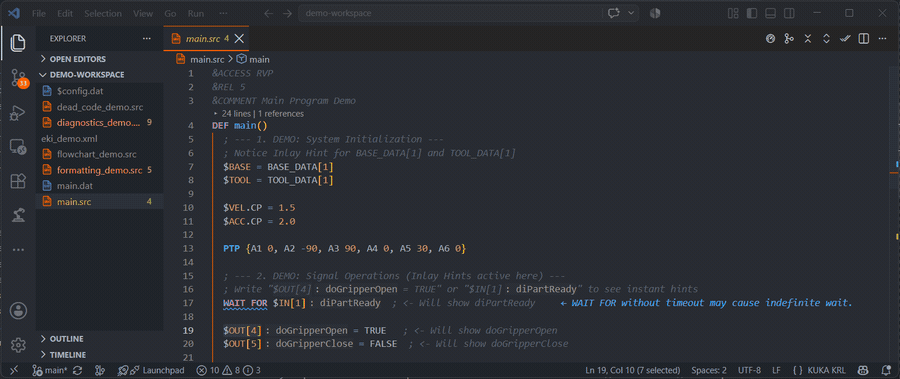

> *Aviso de marcas: KUKA®, WorkVisual®, iiQWorks®, KUKA.Sim®, SmartPAD® y KRL son marcas registradas de KUKA Aktiengesellschaft / KUKA Roboter GmbH. KRL Engineering Toolkit es un producto independiente de Liskin Labs y no está afiliado ni respaldado por KUKA. Las verificaciones offline complementan, pero nunca sustituyen, la validación física de seguridad en el controlador.*

<h1 align="center">KRL Engineering Toolkit para Robótica KUKA®</h1>

<p align="center">
  <b>Envíe código KRL libre de fallos a la célula robótica más rápido.</b><br />
  Análisis previo de seguridad, autoreparación de 7 clases de fallos críticos, diff de copias sin descomprimir, linter VASS 26 y puente SCADA en vivo KSS 8.x / iiQKA.OS en VS Code, Cursor y Windsurf.<br />
  Diseñado para <b>KRC2, KRC4 y KRC5</b> (<code>KSS 5.4–8.7</code> · <code>iiQKA.OS 9.0–9.4</code> · <code>VKRC / VASS 26</code>) · <b>100% RAM local · Cero subidas a la nube</b>
</p>

<p align="center">
  <a href="https://github.com/LiskinLabs/kuka-krl-extension/blob/main/README.md">English</a> ·
  <a href="https://github.com/LiskinLabs/kuka-krl-extension/blob/main/README.ru.md">Русский</a> ·
  <a href="https://github.com/LiskinLabs/kuka-krl-extension/blob/main/README.de.md">Deutsch</a> ·
  <a href="https://github.com/LiskinLabs/kuka-krl-extension/blob/main/README.tr.md">Türkçe</a> ·
  <a href="https://github.com/LiskinLabs/kuka-krl-extension/blob/main/README.es.md"><b>Español</b></a> ·
  <a href="https://github.com/LiskinLabs/kuka-krl-extension/blob/main/README.it.md">Italiano</a>
</p>

<p align="center">
  <a href="https://marketplace.visualstudio.com/items?itemName=LiskinLabs.kuka-krl-extension"></a>
  <a href="https://marketplace.visualstudio.com/items?itemName=LiskinLabs.kuka-krl-extension"></a>
  <a href="https://open-vsx.org/extension/LiskinLabs/kuka-krl-extension"></a>
  <a href="https://github.com/LiskinLabs/kuka-krl-extension/releases"></a>
  <a href="https://secure.software/vscode/packages/liskinlabs/kuka-krl-extension"></a>
  <a href="https://liskinlabs.github.io/kuka-krl-extension/"></a>
  <a href="https://liskinlabs.github.io/kuka-krl-extension/guide/pro-features"></a>
</p>

<p align="center">
  <a href="https://marketplace.visualstudio.com/items?itemName=LiskinLabs.kuka-krl-extension"><b>Instalar desde Marketplace</b></a> ·
  <a href="https://open-vsx.org/extension/LiskinLabs/kuka-krl-extension"><b>Instalar desde Open VSX</b></a> ·
  <a href="https://checkout.dodopayments.com/buy/pdt_0NmAV012KFHSjUMyDomJ6?redirect_url=https%3A%2F%2Fkuka-krl-support-gateway.redminotpro5.workers.dev%2Fcheckout%2Fsuccess%3Flang%3Des&singlePage=true&showDiscounts=true&discountCode=LAUNCH30"><b>Pro Anual (-30% LAUNCH30)</b></a> ·
  <a href="https://liskinlabs.github.io/kuka-krl-extension/"><b>Documentación</b></a> ·
  <a href="https://github.com/LiskinLabs/kuka-krl-extension/blob/main/SUPPORT.md"><b>Soporte y Air-Gap</b></a>
</p>

> **Pruebe las 66 herramientas Pro gratis durante 14 días — sin tarjeta de crédito:** pulse `Ctrl+Shift+P` en VS Code y ejecute **`KRL: Start 14-Day Free Trial`** (`krl.startTrial`), o compare planes con **`KRL: View Pro Plans & Pricing`** (`krl.openPricingPlans`).

<p align="center">
  
</p>

---

## Por qué los integradores abandonan los editores de texto genéricos

Una sola parada evitable durante la puesta en marcha cuesta **USD 10,000+ por hora**. **Una única hora ahorrada en planta amortiza un año completo de Engineer Pro.**

| Fallo en la célula robótica | Qué pasan por alto otros editores | Cómo lo detiene KRL Engineering Toolkit |
|---|---|---|
| **Fallo de interrupción (`KSS 1422`)** | `RESUME` sin desaceleración `BRAKE` previa | Detecta el fallo antes de cargar y `Ctrl+.` inyecta **`BRAKE` antes de `RESUME`** con vista diff |
| **Parada de puntero de avance** | Salidas `$OUT` o esperas en movimiento continuo | **Advance Run Guard** señala la línea exacta y sugiere `TRIGGER WHEN DISTANCE=...` |
| **Deriva nocturna de puntos** | Retoques manuales `E6POS` en SmartPAD sin control | **Backup Diff sin descomprimir** calcula deltas 6D (`ΔX, ΔY, ΔZ, A, B, C`) en `< 80 ms` |
| **Desincronización `;FOLD` / `.dat`** | Ediciones KRL que difieren de `;Params` o `FDAT` | **Integridad 3 vías** alinea `;FOLD`, sentencias, `PDAT`/`LDAT` y `.dat` |
| **Errores ocultos de UTF-8 BOM** | `\xEF\xBB\xBF` o comillas tipográficas bloquean el KSS | **Autoreparación en 1 clic** limpia ASCII inválido y bloques `;FOLD`/`ENDFOLD` |
| **Espera de suites pesadas** | Abrir software complejo solo para revisar señales o `.wvs` | **Puente Node.js nativo** lee `.wvs` y KSS 8.x (`49002`) / iiQKA (`443`) sin DLLs externas |

---

## Respaldo Industrial y Benchmarks Verificados

- **4.13M+ Líneas Auditadas**: probado sobre `108` respaldos reales de planta (`4,136,829` líneas) en `25.4 s`.
- **Base KSS Completa**: `957` variables de sistema (`127` reglas de solo lectura exactas + control por versión), `116` funciones, `111` estructuras, `112` enums, `183` perfiles cinemáticos KUKA y **`135` comandos (`69` Free + `66` Pro)**.
- **Validado en Controladores Reales**: `KSS 8.6.2 (OfficeLite)`, `KSS 8.7 (KR C5)`, `iiQKA 9.2.3 (VRC)` e `iiQKA 9.3.4 (KR C5)`.
- **Seguridad OT**: **ReversingLabs Spectra Assure PASSED (0 CVE)** · `100%` en RAM local · cero subidas de código · activación offline **Air-Gap Ed25519 `.lic`**.

---

## Módulos Principales de Ingeniería

### 1. Puente SCADA en Vivo, Bus I/O, Diagnóstico y Compile Gate `[PRO]`
Conexión Ethernet directa sin WorkVisual, KUKA.Sim, Python ni DLLs de terceros: autodescubrimiento universal con diagnóstico `/24` y **Cross-Subnet Scout** (`krl.liveController.autoScanSubnets`), credenciales por controlador en **VS Code `SecretStorage`** (`krl.live.changeCredentials`), WCF nativo (`49002`), KVP (`7000`), gRPC iiQKA.OS (`443`) y sonda OPC UA (`4840`), sondeo completo de 4096 pines I/O (`$IOSIM_IN[]`/`$IN[]` + filtro **CFG**, bancos de 128 y salto `$IN[n]`), etiquetas **iiQWorks / PROFINET** y descripciones **SmartPAD `UserTexts.kxr`**, historial **Logbook** (`krl.live.openMessages`), tendencias SVG Watch, indicadores de límites de eje, Compile Gate con reintento automático y pestaña **Health / Diagnostics** (7 comprobaciones + informe Markdown).

<p align="center">
  
</p>

### 2. Auditoría Preventiva, Autoreparación 7-Riesgos y VASS 26 / VKRC `[PRO]`
Corrección determinista (`krl.fixAllSafeIssuesInFile`) con Monaco Diff y rollback AST, limpieza de código muerto (`krl.cleanupUnusedVariables`), cinemática para 183 robots, migración bidireccional `KSS 5.4–9.4` (`krl.convertToIiqkaFold`, 15 perfiles + protección VKRC VASS y `127` variables protegidas contra escritura) y reglas completas VW VASS 26 / `VW_USER` (`101..501`).

<p align="center">
  
</p>

### 3. Backup Diff sin Descomprimir, `.wvs`, `.vcmx` y Registros `.evt` `[PRO]`
Monte archivos `.zip`, `.ibz`, `KRCDiag` y `.wvs` en `< 80 ms`, decodifique `.evt` en 6 idiomas, compare deltas 6D, exporte bus de campo `.wvs` a **Siemens TIA Portal / TwinCAT 3 / EPLAN** (`krl.inspectFieldbusTopology`), valide celdas `.vcmx` (`krl.inspectWorkcellLayout`, `krl.validateWorkcellSimulation`) y genere **actas ISO 10218-1/-2**.

<p align="center">
  
</p>

### 4. Diagramas de Flujo, KUKA.RSI 4ms, CAM G-Code y Puente MCP `[PRO]`
Grafos SVG interactivos (`krl.showFlowchart`), RSI `#IPO_FAST` 4ms (`krl.validateRsiXml`, `krl.generateRsiCode`), importador CNC G-Code/SVG (`krl.importGcodeToKrl`), calibración cámara 9 poses (`krl.generateVisionCalibration`) y servidor **MCP local (`127.0.0.1`)** para Cursor, Claude Code y Windsurf.

<p align="center">
  
</p>

### 5. Servidor de Lenguaje KRL de Alta Velocidad — Gratis para Siempre `[FREE CORE]`
Navegación `F12` entre `.src` y `.dat`, autocompletado de **`957` variables**, **`116` funciones**, **`111` structs**, **`112` enums**, formateo, plegado `;FOLD` y **6 temas industriales** sin límite de líneas (`69` herramientas gratuitas).

<p align="center">
  
</p>

---

## Ediciones y Precios Transparentes

**Community Edition:** Gratis para aprendizaje, uso académico y proyectos no comerciales ([LICENSE.txt](https://github.com/LiskinLabs/kuka-krl-extension/blob/main/LICENSE.txt)). Evalúe todas las herramientas Pro con la **prueba gratuita de 14 días** (`krl.startTrial`); el uso comercial continuo requiere licencia Pro, Team, Department o Enterprise.

> **Oferta de Lanzamiento (`LAUNCH30`):** **30% de descuento** preaplicado en los enlaces directos mediante **Dodo Payments** con facturas fiscales automáticas y **0% IVA intracomunitario EU VIES**.

| Plan | Precio estándar | Con `LAUNCH30` (-30%) | Licencias / Plazo | Ideal para | Comprar |
|---|---|---|---|---|---|
| **Community** | USD 0 | USD 0 | Personal / Académico · +14d prueba Pro | Aprendizaje y edición base | [Instalar gratis](https://marketplace.visualstudio.com/items?itemName=LiskinLabs.kuka-krl-extension) |
| **Pro Monthly** | USD 19 / mes | **USD 13.30 / mes** | 1 equipo · Cancela cuando quieras | Puestas en marcha breves | [Mensual](https://checkout.dodopayments.com/buy/pdt_0NmAUzwdbzeERSktsOLTp?redirect_url=https%3A%2F%2Fkuka-krl-support-gateway.redminotpro5.workers.dev%2Fcheckout%2Fsuccess%3Flang%3Des&singlePage=true&showDiscounts=true&discountCode=LAUNCH30) |
| **Pro Annual** *(Recomendado)* | USD 149 / año | **USD 104.30 / año** | 1 equipo · 1 año mejoras | Programadores KUKA | [Anual (-30%)](https://checkout.dodopayments.com/buy/pdt_0NmAV012KFHSjUMyDomJ6?redirect_url=https%3A%2F%2Fkuka-krl-support-gateway.redminotpro5.workers.dev%2Fcheckout%2Fsuccess%3Flang%3Des&singlePage=true&showDiscounts=true&discountCode=LAUNCH30) |
| **Pro Lifetime** | USD 699 pago único | **USD 489.30 único** | 1 equipo · Perpetua | Consultores independientes | [Perpetua](https://checkout.dodopayments.com/buy/pdt_0NmAcoqVCfuwQ6Xx7qyqr?redirect_url=https%3A%2F%2Fkuka-krl-support-gateway.redminotpro5.workers.dev%2Fcheckout%2Fsuccess%3Flang%3Des&singlePage=true&showDiscounts=true&discountCode=LAUNCH30) |
| **Team Edition** | USD 499 / año | **USD 349.30 / año** | **5 equipos** · Factura única | Equipos de célula | [Team (5 puestos)](https://checkout.dodopayments.com/buy/pdt_0NnLCdgD69GiXDLRJ0K5v?redirect_url=https%3A%2F%2Fkuka-krl-support-gateway.redminotpro5.workers.dev%2Fcheckout%2Fsuccess%3Flang%3Des&singlePage=true&showDiscounts=true&discountCode=LAUNCH30) |
| **Department / Integrator** | USD 1,499 / año | **USD 1,049.30 / año** | **20 equipos** · Modo Air-Gap | Integradores de sistemas | [Department (20 puestos)](https://checkout.dodopayments.com/buy/pdt_0Nq5QVTrbkJbWAUf8qoyn?redirect_url=https%3A%2F%2Fkuka-krl-support-gateway.redminotpro5.workers.dev%2Fcheckout%2Fsuccess%3Flang%3Des&singlePage=true&showDiscounts=true&discountCode=LAUNCH30) |
| **Enterprise Plant** | USD 4,999 / año | Presupuesto PO | **100 equipos** · SLA prioritario | Plantas y OEMs | [Solicitar factura B2B](https://github.com/LiskinLabs/kuka-krl-extension/blob/main/SUPPORT.md#2-14-day-free-trial-upgrades--billing-dodo-payments-mor) |

**[Activar Online](https://kuka-krl-support-gateway.redminotpro5.workers.dev/activate)** · **[Generar `.lic` Air-Gap](https://kuka-krl-support-gateway.redminotpro5.workers.dev/airgap)** · **[Portal de Clientes](https://customer.dodopayments.com/login/bus_0NlrxPhrg9eHzPZKAgsF1)**

---

## Inicio Rápido, Air-Gap y Novedades v1.9.26

```bash
code --install-extension LiskinLabs.kuka-krl-extension
```

- **Seguridad OT**: `100%` procesamiento en RAM local ([PRIVACY.md](https://github.com/LiskinLabs/kuka-krl-extension/blob/main/PRIVACY.md)), caché offline de 30 días para licencias comerciales + 14 días de gracia (prueba Pro gratuita de **14 días**) y licencias **Air-Gap Ed25519 `.lic`** (`krl.exportHardwareIdFile` / `krl.importOfflineLicenseFile`).
- **Novedades `v1.9.26`**: Conformidad oficial `KSS 5.4–9.4` (aproximaciones, `TRIGGER PATH`, splines, interrupciones, diagnóstico completo `SPS.SUB`/`.sub`), automatización de movimientos de producción, aislamiento local `.dat` en Rename/References, preservación `;%{PE}` ILF en `KrlFormatter`, decodificación integral `CP1251`/`Windows-1252`/`UTF-16LE`, singularidad de muñeca IK (`|A5| <= 5°`), vistas previas Diff y backups `.bak` en archivos ZIP/TAR, diccionario KSS de 39 códigos en 6 idiomas + parser `krc.log` e inicio diferido del LSP fuera de proyectos KUKA.
- **Novedades `v1.9.25`**: Puente SCADA en vivo (`SecretStorage` por controlador con `krl.live.changeCredentials`, autodescubrimiento `/24` y **Cross-Subnet Scout**, sondeo completo de 4096 pines I/O + filtro **CFG**, etiquetas **iiQWorks / PROFINET** y **SmartPAD `UserTexts.kxr`**, historial **Logbook**, tendencias SVG Watch, sonda **OPC UA `4840`**, reintento en Compile Gate y pestaña **Health / Diagnostics** con 7 comprobaciones y exportación Markdown), además de migración bidireccional `KSS 5.4–9.4` (15 perfiles) y `127` reglas precisas de solo lectura.
- **Lanzamientos anteriores (`v1.9.24`)**: Corrección `CrossMeld 1419/1516`, soporte nativo `.ibz`/`.IBZ` y persistencia de licencia `v4`. Ver [CHANGELOG.md](https://github.com/LiskinLabs/kuka-krl-extension/blob/main/CHANGELOG.md).
- **Cumplimiento ISO 10218-1/-2 e ISO 13849-1**: Software **Non-SIL / Non-PL**; realice siempre validación manual T1 (`$OV_PRO <= 30%`) en el SmartPAD físico.
