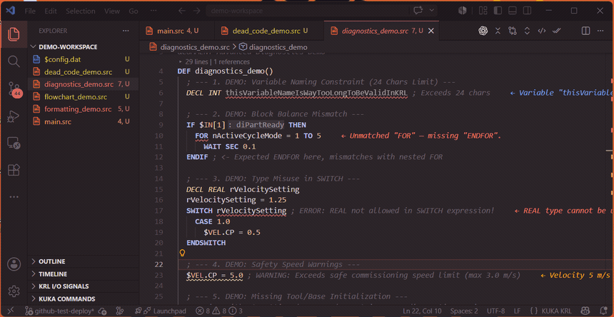

> *Nota sui marchi: KUKA®, WorkVisual®, iiQWorks®, KUKA.Sim®, SmartPAD® e KRL sono marchi registrati di KUKA Aktiengesellschaft / KUKA Roboter GmbH. KRL Engineering Toolkit è un prodotto indipendente di Liskin Labs, non affiliato né sponsorizzato da KUKA. Le verifiche offline integrano e non sostituiscono mai la validazione di sicurezza sul controllore fisico.*

<h1 align="center">KRL Engineering Toolkit per VS Code</h1>

  <b>IDE KRL industriale, analizzatore statico di sicurezza, diff backup e bridge live per robot KUKA.</b> 
  Progettato per <b>KRC2, KRC4 e KRC5</b> (<code>KSS 5.x – 8.7</code> e <code>KSS 9.x / iiQWorks / iiQKA.OS</code>) · <b>100% Offline-First · Zero upload del codice</b>

  [English](https://github.com/LiskinLabs/kuka-krl-extension/blob/main/README.md) · [Русский](https://github.com/LiskinLabs/kuka-krl-extension/blob/main/README.ru.md) · [Deutsch](https://github.com/LiskinLabs/kuka-krl-extension/blob/main/README.de.md) · [Türkçe](https://github.com/LiskinLabs/kuka-krl-extension/blob/main/README.tr.md) · [Español](https://github.com/LiskinLabs/kuka-krl-extension/blob/main/README.es.md) · [Italiano](https://github.com/LiskinLabs/kuka-krl-extension/blob/main/README.it.md)

  
  
  
  
  
  
  

  <a href="https://liskinlabs.github.io/kuka-krl-extension/it/guide/installation"><b>Installazione e Avvio Rapido</b></a> ·
  <a href="https://liskinlabs.github.io/kuka-krl-extension/it/"><b>Documentazione e 64 Guide</b></a> ·
  <a href="https://checkout.dodopayments.com/buy/pdt_0NmAV012KFHSjUMyDomJ6?redirect_url=https%3A%2F%2Fkuka-krl-support-gateway.redminotpro5.workers.dev%2Fcheckout%2Fsuccess%3Flang%3Dit&singlePage=true&showDiscounts=true&discountCode=LAUNCH30"><b>Acquista Pro Annuale (-30%: LAUNCH30)</b></a> ·
  <a href="https://github.com/LiskinLabs/kuka-krl-extension/blob/main/SUPPORT.md"><b>Supporto e Licenze Air-Gap</b></a>

> **Prova gratis tutti i 63 strumenti Pro per 14 giorni (nessuna carta richiesta):** premi `Ctrl+Shift+P` in VS Code ed esegui **`KRL: Start 14-Day Free Trial`** (`krl.startTrial`) oppure **`KRL: Piani e Prezzi Pro`** (`krl.openPricingPlans`).

  

---

## Intercetta i guasti prima che il codice raggiunga il robot

Un'ora di fermo linea costa **oltre 10.000 USD** a causa di arresti di Advance Run (`$OUT` in moto continuo), `RESUME` senza `BRAKE` (`KSS 1422`) o frame `$TOOL`/`$BASE` non inizializzati.

**KRL Engineering Toolkit** porta **126 comandi**, **957 variabili di sistema KSS**, **183 modelli cinematici KUKA**, audit **VASS 26 / VKRC** e **telemetria controllore live** dentro VS Code, Cursor e Windsurf.

| Funzionalità | Community (Gratis) | Pro / Team / Enterprise |
|---|---|---|
| Evidenziazione KRL, 6 temi industriali, completamento (`957` variabili KSS, `116` funzioni) | Righe illimitate | Righe illimitate |
| Navigazione `F12` (`.src` ↔ `.dat`), riferimenti, formattatore, FOLD/ENDFOLD, ordinamento | Incluso | Incluso |
| Diagnostica sintassi, bilanciamento blocchi, controlli frame base e snippet KRL | Incluso | Incluso |
| Controlli pre-deployment: Advance Run Guard, cinematica `S/T`, inviluppo 183 robot | Valutazione 30 giorni | Uso produttivo completo |
| Linter automotive VASS 26 / `VW_USER` (`101..501`) e integrità a 3 vie `FOLD` vs `.dat` | — | Uso produttivo completo |
| Telemetria KSS 8.x WCF (porta `49002`) e iiQKA.OS, messaggi SmartPAD, Compile Gate | — | Uso produttivo completo |
| Mount `.zip`/`.wvs` senza estrazione, delta punti (`ΔX/Y/Z`), trasformazioni 6D e decoder `.evt` | — | Uso produttivo completo |

---

## Moduli Ingegneristici Principali

### 1. Bridge Live Controllore &amp; Messaggi SmartPAD (`KSS 8.x` &amp; `iiQKA.OS 9.x`)
- **Client WCF nativo KSS 8.x**: Eseguito interamente in Node.js sulla porta `49002`, senza WorkVisual, KUKA.Sim, Python o DLL di terze parti.
- **iiQKA.OS (`KRC5`) &amp; Compile Gate**: Monitora `$TOOL`/`$BASE`, coppie/correnti/temperature assi, PGNO, pacchetti KOP e storico messaggi SmartPAD (`krl.live.openMessages`).
- **Inlay Hints I/O in tempo reale**: Mostra i nomi logici accanto a `$IN[x]`, `$OUT[y]` e `$FLAG[z]` nell'editor.

  

### 2. Sicurezza Pre-Deployment, Cinematica &amp; VASS 26 / VKRC
- **Guardie Cinematiche**: Previene singolarità polso/spalla, archi `CIRC` collineari, `$APO.CDIS > 50%`, errori `Status/Turn` e limiti di sbraccio su **183 robot KUKA**.
- **Integrità Dati Movimento a 3 Vie**: Scopre incongruenze silenziose tra intestazioni `;FOLD` e strutture `.dat` (`PDAT`/`LDAT`/`FDAT`).
- **Suite Automotive VASS 26 / VKRC**: Verifica completa di `Folge`, `UP`, `MakroSps`, `VW_USER` (`101..501`) e interblocchi di sicurezza.

  

### 3. Diff Backup SmartPAD, Trasformazioni 6D &amp; Log Binari `.evt`
- **Esplorazione `.zip` / `.wvs` senza estrazione**: Analizza archivi in RAM, decodifica log `.evt` (EVTX) in 6 lingue ed esporta report ISO 10218-1.
- **Point Delta Inspector**: Evidenzia gli scostamenti di coordinate (`ΔX, ΔY, ΔZ, A, B, C`) tra versioni di backup.
- **Shift e Mirroring 6D in Batch**: Anteprima Monaco Diff con rollback atomico tramite checksum AST.

  

### 4. Language Server KRL ad Alte Prestazioni (Base Community Gratuita)
Navigazione `F12` tra `.src` e `.dat`, completamento intelligente, formattazione, `FOLD`/`ENDFOLD`, ordinamento dichiarazioni e analisi sintattica **gratis per sempre senza limiti di righe**.

  

---

## Edizioni, EULA e Prezzi Trasparenti

**Licenza Community:** Gratuita per studio personale, ricerca accademica non commerciale e **valutazione commerciale di 30 giorni** non in produzione (vedi [LICENSE.txt](https://github.com/LiskinLabs/kuka-krl-extension/blob/main/LICENSE.txt)). L'uso commerciale o produttivo continuativo richiede una licenza Pro, Team, Department o Enterprise.

> **Promo Lancio (`LAUNCH30`):** Codice **`LAUNCH30`** per il **30% di sconto** sul primo acquisto (pre-applicato nei link sotto). Pagamenti gestiti da **Dodo Payments** (Merchant of Record) con **0% Reverse Charge UE VIES** e fatture PDF automatiche.

| Piano | Prezzo Listino | Con `LAUNCH30` (-30%) | Attivazioni / Durata | Ideale Per | Azione |
|---|---|---|---|---|---|
| **Community** | 0 USD | 0 USD | Personale / Accademico / 30 gg eval | Studio e uso non commerciale | [Installa Gratis](https://marketplace.visualstudio.com/items?itemName=LiskinLabs.kuka-krl-extension) |
| **Pro Monthly** | 19 USD / mese | **13.30 USD / mese** | 1 postazione · Disdici quando vuoi | Trasferte brevi | [Acquista Mensile](https://checkout.dodopayments.com/buy/pdt_0NmAUzwdbzeERSktsOLTp?redirect_url=https%3A%2F%2Fkuka-krl-support-gateway.redminotpro5.workers.dev%2Fcheckout%2Fsuccess%3Flang%3Dit&singlePage=true&showDiscounts=true&discountCode=LAUNCH30) |
| **Pro Annual** *(Consigliato)* | 149 USD / anno | **104.30 USD / anno** | 1 postazione · 1 anno aggiornamenti | Ingegneri robotica | [Acquista Annuale (-30%)](https://checkout.dodopayments.com/buy/pdt_0NmAV012KFHSjUMyDomJ6?redirect_url=https%3A%2F%2Fkuka-krl-support-gateway.redminotpro5.workers.dev%2Fcheckout%2Fsuccess%3Flang%3Dit&singlePage=true&showDiscounts=true&discountCode=LAUNCH30) |
| **Pro Lifetime** | 699 USD una tantum | **489.30 USD una tantum** | 1 postazione · Perpetua | Consulenti indipendenti | [Acquista Lifetime](https://checkout.dodopayments.com/buy/pdt_0NmAcoqVCfuwQ6Xx7qyqr?redirect_url=https%3A%2F%2Fkuka-krl-support-gateway.redminotpro5.workers.dev%2Fcheckout%2Fsuccess%3Flang%3Dit&singlePage=true&showDiscounts=true&discountCode=LAUNCH30) |
| **Team Edition** | 499 USD / anno | **349.30 USD / anno** | **5 postazioni** · Fattura unica | Team di cella robotica | [Acquista Team (5)](https://checkout.dodopayments.com/buy/pdt_0NnLCdgD69GiXDLRJ0K5v?redirect_url=https%3A%2F%2Fkuka-krl-support-gateway.redminotpro5.workers.dev%2Fcheckout%2Fsuccess%3Flang%3Dit&singlePage=true&showDiscounts=true&discountCode=LAUNCH30) |
| **Department / Integrator** | 1,499 USD / anno | **1,049.30 USD / anno** | **20 postazioni** · Air-Gap | System integrator | [Acquista Integrator (20)](https://checkout.dodopayments.com/buy/pdt_0Nq5QVTrbkJbWAUf8qoyn?redirect_url=https%3A%2F%2Fkuka-krl-support-gateway.redminotpro5.workers.dev%2Fcheckout%2Fsuccess%3Flang%3Dit&singlePage=true&showDiscounts=true&discountCode=LAUNCH30) |
| **Enterprise Plant** | 4,999 USD / anno | Offerta su PO | **100 postazioni** · Supporto prioritario | Stabilimenti e OEM | [Richiedi Fattura B2B](https://github.com/LiskinLabs/kuka-krl-extension/blob/main/SUPPORT.md#2-14-day-free-trial-upgrades--billing-dodo-payments-mor) |

Hai già una chiave? **[Attiva Online](https://kuka-krl-support-gateway.redminotpro5.workers.dev/activate?lang=it)** · **[Portale Air-Gap `.lic`](https://kuka-krl-support-gateway.redminotpro5.workers.dev/airgap)** · **[Portale Clienti e Fatture](https://customer.dodopayments.com/login/bus_0NlrxPhrg9eHzPZKAgsF1)**

---

## Affidabilità in Reparto &amp; Reti Air-Gap

- **100% Elaborazione Locale**: I file `.src`, `.dat`, `.sub` e i backup non lasciano mai il tuo PC ([PRIVACY.md](https://github.com/LiskinLabs/kuka-krl-extension/blob/main/PRIVACY.md)).
- **Cache Offline 30 Giorni + 14 Giorni di Grazia**: Continuità garantita nelle celle industriali isolate.
- **Modalità Air-Gap Completa**: Genera file `.lic` firmati Ed25519 dal [Portale Air-Gap](https://kuka-krl-support-gateway.redminotpro5.workers.dev/airgap) e importali con `krl.importOfflineLicenseFile`.

---

## Novità nella v1.9.17

- **Client WCF nativo KSS 8.x**: Telemetria su porta `49002` in puro Node.js senza WorkVisual, KUKA.Sim o DLL esterne.
- **Telemetria completa iiQKA.OS &amp; Messaggi SmartPAD**: Frame Tool/Base, interblocchi, coppie/temperature/correnti, PGNO, KOP e `krl.live.openMessages`.
- **Compile Gate iiQKA.OS &amp; Migrazione (`KSS 8.3 – 9.3`)**: Validato dal vivo su KSS 8.6.2, KSS 8.7, iiQKA 9.2.3 e iiQKA 9.3.4 ([CHANGELOG.md](https://github.com/LiskinLabs/kuka-krl-extension/blob/main/CHANGELOG.md)).
