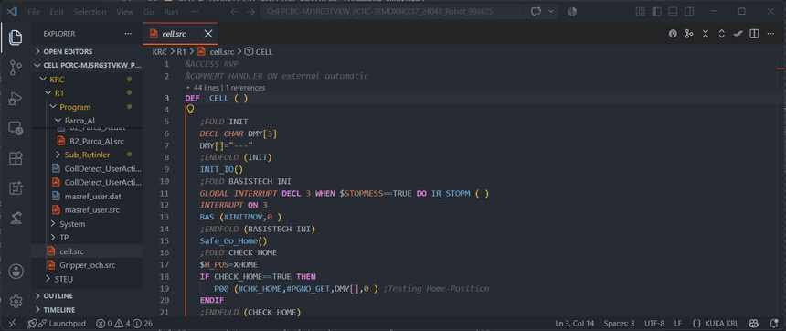

<h1 align="center">KRL Engineering Toolkit for KUKA® Robotics</h1>

<p align="center">
  <b>Ship crash-free KRL to the robot cell faster.</b><br />
  Pre-deployment safety analysis, 7-hazard auto-repair, zero-unpack backup diff, VASS 26 linting &amp; live KSS 8.x / iiQKA.OS controller telemetry inside VS Code, Cursor &amp; Windsurf.<br />
  Built for <b>KRC2, KRC4 &amp; KRC5</b> (<code>KSS 5.x–8.7</code> · <code>iiQKA.OS 9.x</code> · <code>VKRC / VASS 26</code>) · <b>100% Local RAM Processing · Zero Cloud Code Uploads</b>
</p>

<p align="center">
  <a href="https://github.com/LiskinLabs/kuka-krl-extension/blob/main/README.md"><b>English</b></a> ·
  <a href="https://github.com/LiskinLabs/kuka-krl-extension/blob/main/README.ru.md">Русский</a> ·
  <a href="https://github.com/LiskinLabs/kuka-krl-extension/blob/main/README.de.md">Deutsch</a> ·
  <a href="https://github.com/LiskinLabs/kuka-krl-extension/blob/main/README.tr.md">Türkçe</a> ·
  <a href="https://github.com/LiskinLabs/kuka-krl-extension/blob/main/README.es.md">Español</a> ·
  <a href="https://github.com/LiskinLabs/kuka-krl-extension/blob/main/README.it.md">Italiano</a>
</p>

<p align="center">
  <a href="https://marketplace.visualstudio.com/items?itemName=LiskinLabs.kuka-krl-extension"></a>
  <a href="https://marketplace.visualstudio.com/items?itemName=LiskinLabs.kuka-krl-extension"></a>
  <a href="https://open-vsx.org/extension/LiskinLabs/kuka-krl-extension"></a>
  <a href="https://github.com/LiskinLabs/kuka-krl-extension/releases"></a>
  <a href="https://secure.software/vscode/packages/liskinlabs/kuka-krl-extension"></a>
  <a href="https://liskinlabs.github.io/kuka-krl-extension/"></a>
  <a href="https://liskinlabs.github.io/kuka-krl-extension/guide/pro-features"></a>
</p>

<p align="center">
  <a href="https://marketplace.visualstudio.com/items?itemName=LiskinLabs.kuka-krl-extension"><b>Install from Marketplace</b></a> ·
  <a href="https://open-vsx.org/extension/LiskinLabs/kuka-krl-extension"><b>Install from Open VSX</b></a> ·
  <a href="https://checkout.dodopayments.com/buy/pdt_0NmAV012KFHSjUMyDomJ6?redirect_url=https%3A%2F%2Fkuka-krl-support-gateway.redminotpro5.workers.dev%2Fcheckout%2Fsuccess%3Flang%3Den&singlePage=true&showDiscounts=true&discountCode=LAUNCH30"><b>Get Pro Annual (-30% LAUNCH30)</b></a> ·
  <a href="https://liskinlabs.github.io/kuka-krl-extension/"><b>Docs &amp; Guides</b></a> ·
  <a href="https://github.com/LiskinLabs/kuka-krl-extension/blob/main/SUPPORT.md"><b>Support &amp; Air-Gap Licensing</b></a>
</p>

> **Try all 63 Pro engineering tools free for 14 days — no credit card required:** press `Ctrl+Shift+P` inside VS Code and run **`KRL: Start 14-Day Free Trial`** (`krl.startTrial`), or open side-by-side plan pricing with **`KRL: View Pro Plans & Pricing`** (`krl.openPricingPlans`).

<p align="center">
  
</p>

---

## Why Commissioning Teams Stop Editing KRL in Plain Text Editors

A single preventable fault during plant ramp-up costs **USD 10,000+ per hour** in stalled conveyors, scrap cycles, and overnight commissioning overtime. **One saved commissioning hour pays for an entire year of Engineer Pro.**

| Production Fault on the Robot Cell | What Generic Editors Miss | How KRL Engineering Toolkit Stops It |
|---|---|---|
| **Interrupt Crash (`KSS 1422`)** | Unprotected `RESUME` inside interrupt subroutines | Static analyzer flags missing deceleration & `Ctrl+.` injects **`BRAKE` before `RESUME`** with diff preview |
| **Advance Run Stop (`$OUT` / `WAIT` Sync)** | Main-run triggers inside blended spline/CP motion | **Advance Run Guard** pinpoints every advance-breaking line & recommends `TRIGGER WHEN DISTANCE=...` |
| **Night-Shift SmartPAD Point Drift** | Operators touch up `E6POS` coordinates without tracking | **Zero-Unpack Backup Diff** computes 6D deltas (`ΔX, ΔY, ΔZ, A, B, C`) in `< 80 ms` and flags drift past `±1.0 mm` |
| **Inline-Form `;FOLD` / `.dat` Desync** | Manual KRL edits diverge from XML `;Params` or `FDAT` | **Motion 3-Way Integrity** aligns `;FOLD` headers, statements, `PDAT`/`LDAT` profiles & companion `.dat` files |
| **Silent UTF-8 BOM & Encoding Panics** | Hidden `\xEF\xBB\xBF`, smart quotes, or umlauts abort KSS upload | **1-Click Safe Auto-Repair** sanitizes non-ASCII artifacts and broken `;FOLD`/`ENDFOLD` nesting before transfer |
| **Wasted Hours Booting Heavy Suites** | Opening full vendor IDE just to inspect signals or `.wvs` | **Pure Node.js Live Bridge** inspects `.wvs` fieldbus topology & streams KSS 8.x (`49002`) / iiQKA (`443`) with zero vendor DLLs |

---

## Industrial Proof & Verified Benchmarks

- **4.13M+ Lines Fleet Audited**: Benchmarked on `108` real factory KUKA backups (`4,136,829` lines) end-to-end in `25.4 s`.
- **Deep Native KSS Knowledge Base**: `957` built-in system variables, `116` KRL functions, `111` structs, `112` enums, `183` KUKA robot kinematic/reach profiles, and **`126` commands (`63` Free Core + `63` Pro Engineering Tools)**.
- **Live-Controller Validated**: Tested against live targets on `KSS 8.6.2 (OfficeLite)`, `KSS 8.7 (KR C5)`, `iiQKA 9.2.3 (VRC)`, and `iiQKA 9.3.4 (KR C5)`.
- **OT Security & Supply-Chain Verified**: **ReversingLabs Spectra Assure PASSED (0 CVE)** · `100%` local RAM processing · zero source code ever uploaded · supports shielded **Air-Gap Ed25519 `.lic`** licensing.

---

## Core Engineering Suites

### 1. Live Controller Telemetry, SmartPAD Messages & Compile Gate `[PRO]`
Connect directly from your laptop over industrial Ethernet — **no WorkVisual, KUKA.Sim, Python, or third-party vendor DLLs required**:
- **Native KSS 8.x WCF OnlineServices (`49002`) & KUKAVARPROXY/C3Bridge (`7000`)**: Pure TypeScript/Node.js transport streaming live controller state with zero external runtime dependencies.
- **iiQKA.OS (`KRC5` / `9.x`) gRPC Bridge (`443`) & Compile Gate**: Reads live `$TOOL`/`$BASE` frames, safety interlocks, per-axis torques/currents/temperatures, soft limits, PGNO handshakes, installed KOP packages, and executes controller-side compile checks (`SynchronizeMirror -> AnalyzeAllKrlFiles -> GetModuleInfos`).
- **Live I/O Signal Inspector & Searchable SmartPAD History**: Inline alias hints next to `$IN[1..4096]`, `$OUT[1..4096]`, and `$FLAG[z]`, hot `.zip` / `.ibz` backup extraction, plus a 200-entry filterable SmartPAD message panel (`krl.live.openMessages`).

<p align="center">
  
</p>

### 2. Pre-Flight Safety Lint, 7-Hazard Auto-Repair & VASS 26 / VKRC Suite `[PRO]`
Catch kinematics crashes, automotive standard violations, and KSS version traps before loading code to the pendant:
- **7-Hazard Deterministic Safe Auto-Repair (`krl.fixAllSafeIssuesInFile`)**: Fixes BOM/non-ASCII pollution, missing `BRAKE` before `RESUME`, un-committed `$LOAD`/`BAS(#TOOL)` payloads, `;FOLD`/`ENDFOLD` desync, fatal `FOR STEP 0` infinite loops, duplicate blending modifiers (`C_DIS`, `C_PTP`), and Inline-Form XML `;Params` drift inside a safe Monaco Diff Review with AST Rollback Guard.
- **Kinematics & Envelope Guards Across 183 KUKA Robots**: Detects wrist/shoulder singularities, collinear `CIRCLE` targets, `$APO.CDIS` over-approximation, `Status`/`Turn` bitmask traps, and reach limit violations.
- **Version-Aware KSS `8.3 – 9.3` Migration (`krl.convertToIiqkaFold`)**: Migrates full workspaces/backups with exact `PDAT`/`LDAT` (`SVEL_CP2`/`SACC_CP2`, `MotionParamSets.dat`) and FOLD consistency rules.
- **Volkswagen VASS 26 / VKRC Linter**: Dedicated offline validation for `Folge`, `UP`, `MakroSps`, `VW_USER` (`101..501`), safety gate interlocks, and `Genau` tolerances, plus project-wide dead-code purge (`krl.cleanupUnusedVariables`).

<p align="center">
  
</p>

### 3. Zero-Unpack Backup Diff, `.wvs` Fieldbus Inspector, `.vcmx` Validator & `.evt` Logs `[PRO]`
Work directly inside plant backups without cluttering engineering laptops with extracted folders:
- **Zero-Unpack `.zip` / `.ibz` / `KRCDiag` / `.wvs` Mounting**: Open robot archives directly as VS Code project workspaces (`< 80 ms` in-memory save) and decode multi-language Windows EVTX `.evt` controller crash logs offline across 6 languages.
- **6D Point Delta Diff & Batch Frame Transforms**: Compare shift backups side-by-side (`ΔX, ΔY, ΔZ, A, B, C`) and batch-shift or mirror `E6POS` trajectories across Tool/Base frames with diff previews.
- **WorkVisual `.wvs` Fieldbus Export (`krl.inspectFieldbusTopology`)**: Extracts KOP catalogs, EtherCAT/PROFINET I/O mappings and exports directly to **Siemens TIA Portal**, **Beckhoff TwinCAT 3**, and **EPLAN**.
- **3D Workcell `.vcmx` Validator & ISO Acceptance Protocols**: Detects `VCMX001–VCMX004` simulation deadlocks (`krl.inspectWorkcellLayout`, `krl.validateWorkcellSimulation`) and generates print-ready **ISO 10218-1/-2 Commissioning Acceptance Reports**.

<p align="center">
  
</p>

### 4. Interactive Flowcharts, KUKA.RSI 4ms, CAM G-Code & MCP AI Bridge `[PRO]`
- **Bi-Directional SVG Control Flow Graph (`krl.showFlowchart`)**: Click any `IF`, `SWITCH`, `LOOP`, `FOR`, or subroutine node to jump directly to its KRL source line, or export clean SVGs for customer dossiers.
- **KUKA.RobotSensorInterface 4ms (`krl.validateRsiXml`, `krl.generateRsiCode`)**: Validates XML socket descriptors and scaffolds `#IPO_FAST` (`250 Hz`) `#POSCORR` / `#AXISCORR` loops for seam tracking and ROS 2 bridges.
- **CAM CNC G-Code / SVG Importer (`krl.importGcodeToKrl`) & 9-Pose Vision Calibration (`krl.generateVisionCalibration`)**: Turns ISO `G0`–`G3` paths and SVG contours into ready KRL motion modules and computes 3D camera hand-eye transforms.
- **Local Authenticated MCP AI Bridge (`127.0.0.1`)**: Exposes `krl_live_telemetry`, `krl_workspace_diagnostics`, `krl_safe_auto_repair`, and `krl_system_variable_spec` locally to Cursor, Claude Code, Windsurf, and MCP agents with zero cloud telemetry.

<p align="center">
  
</p>

### 5. High-Speed KRL Language Server — Free Forever for Every Roboticist `[FREE CORE]`
Even without a Pro license, you get a complete, unlimited-line daily KRL IDE (`63` Free Commands):
- Instant cross-file `F12` Go-to-Definition (`.src` <-> `.dat`), Find All References, Rename Symbol, Document Outline, and Call Hierarchy.
- Context-aware autocomplete & hover docs for **`957` KSS system variables**, **`116` functions**, **`111` structs**, **`112` enums**, plus inline I/O signal hints.
- `;FOLD` / `;ENDFOLD` auto-folding, declaration sorter, block balancer, formatter, real-time syntax diagnostics, and **6 industrial color themes** (including dark shop-floor & OLED modes).

<p align="center">
  
</p>

<details>
<summary><b>Click to expand: Quick Keyboard Shortcuts &amp; Verified Command Reference</b></summary>

| Action / Workflow | Command ID / Shortcut | Edition |
|---|---|---|
| Open Control Center Hub | `krl.openControlCenter` | Free + Pro |
| Start 14-Day Free Pro Trial (No Card) | `krl.startTrial` | Free → Trial |
| Compare Editions &amp; Buy with `LAUNCH30` | `krl.openPricingPlans` | Free + Pro |
| Jump Between `.src` ↔ `.dat` Declaration | `F12` / `Shift+F12` | Free |
| Quick-Fix Safe Hazards (BOM / `BRAKE` / FOLD) | `Ctrl+.` / `krl.fixAllSafeIssuesInFile` | Pro / Trial |
| Purge Unused Variables &amp; Dead Code | `krl.cleanupUnusedVariables` | Pro / Trial |
| Live SmartPAD Message History (200 entries) | `krl.live.openMessages` | Pro / Trial |
| Interactive SVG Control Flowchart | `krl.showFlowchart` | Pro / Trial |
| `.wvs` Fieldbus Export (TIA / TwinCAT / EPLAN) | `krl.inspectFieldbusTopology` | Pro / Trial |
| `.vcmx` Simulation Layout &amp; Deadlock Audit | `krl.inspectWorkcellLayout` / `krl.validateWorkcellSimulation` | Pro / Trial |
| KSS 8.3–9.3 Workspace Migration | `krl.convertToIiqkaFold` | Pro / Trial |
| Air-Gap Hardware ID &amp; Offline `.lic` Import | `krl.exportHardwareIdFile` / `krl.importOfflineLicenseFile` | Pro / Team / Ent |

</details>

---

## Editions, EULA & Transparent Pricing

**Community Edition License:** Free forever for personal learning, academic teaching, and non-commercial research ([LICENSE.txt](https://github.com/LiskinLabs/kuka-krl-extension/blob/main/LICENSE.txt)). Commercial Pro features can be evaluated via the **14-day Free Trial** (`krl.startTrial`); ongoing commercial engineering and plant commissioning require an active Pro, Team, Department, or Enterprise license.

| Capability | Community (Free) | Pro / Team / Department / Enterprise |
|---|---|---|
| Full KRL lexer, 6 shop-floor themes, smart autocomplete (`957` KSS vars, `116` funcs) | Unlimited lines | Unlimited lines |
| Cross-file `F12` Go-to-Definition, Find References, Outline, Formatting &amp; Declaration Sorter | Included | Included |
| Syntax diagnostics, block balancing, basic frame checks &amp; industrial snippet library | Included | Included |
| Pre-deployment safety audit: Advance Run Guard, `S/T` kinematics, 183-robot reach check | 14-day Pro trial | Full production |
| 7-hazard Safe Auto-Repair, VASS 26 / `VW_USER` (`101..501`) &amp; Motion 3-Way Integrity | 14-day Pro trial | Full production |
| Live KSS 8.x WCF (`49002`) &amp; iiQKA.OS gRPC (`443`) telemetry + Compile Gate | 14-day Pro trial | Full production |
| Zero-unpack `.zip`/`.wvs`/`.vcmx`/`.evt` analyzers, 6D Backup Diff, Flowcharts, RSI, CAM &amp; MCP | 14-day Pro trial | Full production |
| Air-Gap Ed25519 `.lic` activation, multi-seat fleet management &amp; EU VAT invoicing | — | Included |

> **Launch Promo (`LAUNCH30`):** Apply promo code **`LAUNCH30`** for **30% off** your checkout (pre-applied in every direct checkout link below). Payments are processed securely via **Dodo Payments** (Merchant of Record) with global VAT/Sales Tax handling, **0% EU VIES Reverse Charge**, wire/card support, and instant PDF tax invoices.

| Plan | Standard Price | Launch Price (`LAUNCH30`, -30%) | Seats / Terms | Best For | Checkout |
|---|---|---|---|---|---|
| **Community** | USD 0 | USD 0 | Personal / Academic · +14-day Pro trial | Learning &amp; non-commercial editing | [Install Free](https://marketplace.visualstudio.com/items?itemName=LiskinLabs.kuka-krl-extension) |
| **Pro Monthly** | USD 19 / mo | **USD 13.30 / mo** | 1 workstation · Cancel anytime | Short commissioning trips | [Buy Monthly](https://checkout.dodopayments.com/buy/pdt_0NmAUzwdbzeERSktsOLTp?redirect_url=https%3A%2F%2Fkuka-krl-support-gateway.redminotpro5.workers.dev%2Fcheckout%2Fsuccess%3Flang%3Den&singlePage=true&showDiscounts=true&discountCode=LAUNCH30) |
| **Pro Annual** *(Best Value)* | USD 149 / yr | **USD 104.30 / yr** | 1 workstation · 1 year updates | Full-time KUKA programmers | [Buy Annual (-30%)](https://checkout.dodopayments.com/buy/pdt_0NmAV012KFHSjUMyDomJ6?redirect_url=https%3A%2F%2Fkuka-krl-support-gateway.redminotpro5.workers.dev%2Fcheckout%2Fsuccess%3Flang%3Den&singlePage=true&showDiscounts=true&discountCode=LAUNCH30) |
| **Pro Lifetime** | USD 699 once | **USD 489.30 once** | 1 workstation · Perpetual | Independent consultants | [Buy Lifetime](https://checkout.dodopayments.com/buy/pdt_0NmAcoqVCfuwQ6Xx7qyqr?redirect_url=https%3A%2F%2Fkuka-krl-support-gateway.redminotpro5.workers.dev%2Fcheckout%2Fsuccess%3Flang%3Den&singlePage=true&showDiscounts=true&discountCode=LAUNCH30) |
| **Team Edition** | USD 499 / yr | **USD 349.30 / yr** | **5 workstations** · Single invoice | Automation cell teams | [Buy Team (5 Seats)](https://checkout.dodopayments.com/buy/pdt_0NnLCdgD69GiXDLRJ0K5v?redirect_url=https%3A%2F%2Fkuka-krl-support-gateway.redminotpro5.workers.dev%2Fcheckout%2Fsuccess%3Flang%3Den&singlePage=true&showDiscounts=true&discountCode=LAUNCH30) |
| **Department / Integrator** | USD 1,499 / yr | **USD 1,049.30 / yr** | **20 workstations** · Air-Gap support | System integration firms | [Buy Department (20 Seats)](https://checkout.dodopayments.com/buy/pdt_0Nq5QVTrbkJbWAUf8qoyn?redirect_url=https%3A%2F%2Fkuka-krl-support-gateway.redminotpro5.workers.dev%2Fcheckout%2Fsuccess%3Flang%3Den&singlePage=true&showDiscounts=true&discountCode=LAUNCH30) |
| **Enterprise Plant** | USD 4,999 / yr | Custom PO Quote | **100 workstations** · Priority SLA | Automotive plants &amp; OEMs | [Request Corporate Invoice](https://github.com/LiskinLabs/kuka-krl-extension/blob/main/SUPPORT.md#2-14-day-free-trial-upgrades--billing-dodo-payments-mor) |

Already purchased? **[Activate Online](https://kuka-krl-support-gateway.redminotpro5.workers.dev/activate)** · **[Generate Air-Gap `.lic` File](https://kuka-krl-support-gateway.redminotpro5.workers.dev/airgap)** · **[Customer Portal &amp; VAT Invoices](https://customer.dodopayments.com/login/bus_0NlrxPhrg9eHzPZKAgsF1)**

---

## 30-Second Quick Start & Shop-Floor Air-Gap Resilience

```bash
code --install-extension LiskinLabs.kuka-krl-extension
```

1. **Open any KRL folder or backup archive** (`.src`, `.dat`, `.sub`, `.zip`, `.ibz`, `.wvs`, `.vcmx`, `.evt`).
2. Press `Ctrl+Shift+P` → **`KRL: Start 14-Day Free Trial`** (`krl.startTrial`) to unlock all `63` Pro modules immediately, or **`KRL: Open Control Center`** (`krl.openControlCenter`).
3. **Audit offline or connect live** over Ethernet (`49002` KSS 8.x WCF, `7000` KVP, or `443` iiQKA.OS gRPC).

- **100% Local RAM Processing**: All robot programs, backups, and EVTX logs stay on your machine ([PRIVACY.md](https://github.com/LiskinLabs/kuka-krl-extension/blob/main/PRIVACY.md)).
- **Paid License Offline Cache (30 Days + 14-Day Grace)**: Once activated, commercial seats operate inside shielded factory cells for 30 days without internet checks (note: the free Pro trial itself runs for **14 days**).
- **Full Air-Gap `.lic` Workflow**: Export hardware ID via `krl.exportHardwareIdFile`, generate a cryptographically signed Ed25519 license at the [Air-Gap Portal](https://kuka-krl-support-gateway.redminotpro5.workers.dev/airgap), and import via `krl.importOfflineLicenseFile`.

---

## What's New in v1.9.24

- **Live `CrossMeld` Fix, Native `.ibz` &amp; Persistent Licensing (`v1.9.24`)**: Eliminated SmartPAD `CrossMeld 1419`/`1516` notification spam when connecting online without a selected program/base, added native `.ibz` / `.IBZ` custom-editor &amp; explorer registration, hardened Ed25519/Dodo license gates with update-resilient `v4` machine mirror persistence (`~/.liskinlabs/license-state.json`), and aligned docs to the **14-day Free Trial**.
- **Open VSX Single-Line Secret-Scan Fix (`v1.9.20 – v1.9.23`)**: Unified single-line bundle minification and inline suppression markers so Marketplace &amp; Open VSX publish cleanly in sync.
- **Unified In-IDE Trial &amp; B2B Checkout (`v1.9.18 – v1.9.19`)**: Side-by-side `krl.openPricingPlans` comparison, `krl.startTrial` 14-day trial flow, `LAUNCH30` (`30% OFF`), and native KSS 8.x (`49002`) / iiQKA.OS 9.x telemetry (`krl.live.openMessages`).
- **Full Release Notes**: See [CHANGELOG.md](https://github.com/LiskinLabs/kuka-krl-extension/blob/main/CHANGELOG.md).

---

## Safety Compliance (ISO 10218-1/-2 & ISO 13849-1) & Legal Disclaimers

**KRL Engineering Toolkit** is an independent software engineering, static analysis, and diagnostics tool by **Liskin Labs**. It is **NOT safety-certified software (Non-SIL / Non-PL)** and does **not** replace physical commissioning verification, reduced speed manual tests (`$OV_PRO <= 30%` in `T1` mode on the physical KUKA SmartPAD), or formal safety risk assessments under **ISO 10218-1/-2** and **ISO 13849-1**.

### Trademarks

KUKA®, WorkVisual®, iiQWorks®, KUKA.Sim®, SmartPAD®, and KRL are registered trademarks of KUKA Aktiengesellschaft / KUKA Roboter GmbH. **KRL Engineering Toolkit** is an independent product by **Liskin Labs** and is not affiliated with, endorsed by, or sponsored by KUKA. Offline checks complement, and never replace, physical controller-side safety validation.
