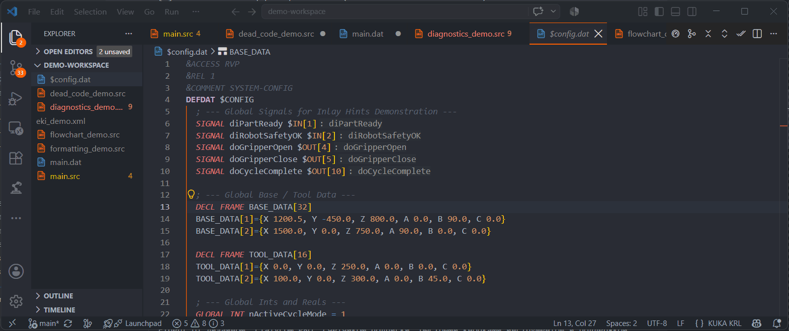
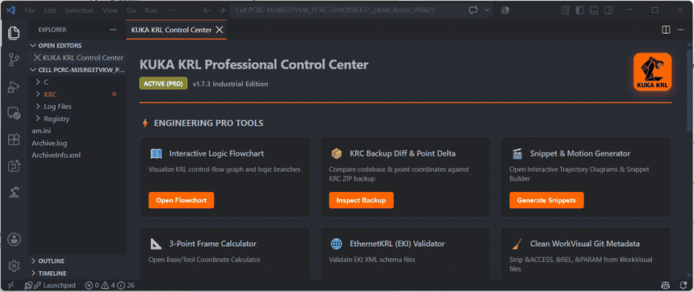
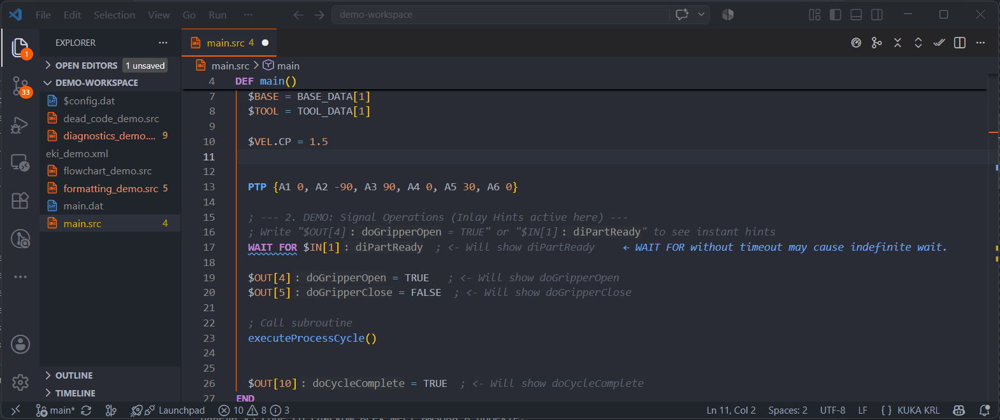

<h1 align="center">KRL Engineering Toolkit для роботов KUKA®</h1>

<p align="center">
  Языковой сервер KRL, статический анализ безопасности, сравнение бэкапов без распаковки, инспектор WorkVisual (<code>.wvs</code>) и живая телеметрия контроллера в VS Code, Cursor и Windsurf.<br />
  Поддержка <b>KR C2, KR C4 и KR C5 (micro / -2)</b> · <code>KSS 5.4–8.7</code> · <code>VSS (VKRC) 8.3–8.7</code> · <code>iiQKA.OS2 9.0–9.3</code> · <b>100% локально в RAM · Без отправки кода в облако</b>
</p>

<p align="center">
  <a href="https://github.com/LiskinLabs/kuka-krl-extension/blob/main/README.md">English</a> ·
  <a href="https://github.com/LiskinLabs/kuka-krl-extension/blob/main/README.ru.md"><b>Русский</b></a> ·
  <a href="https://github.com/LiskinLabs/kuka-krl-extension/blob/main/README.de.md">Deutsch</a> ·
  <a href="https://github.com/LiskinLabs/kuka-krl-extension/blob/main/README.tr.md">Türkçe</a> ·
  <a href="https://github.com/LiskinLabs/kuka-krl-extension/blob/main/README.es.md">Español</a> ·
  <a href="https://github.com/LiskinLabs/kuka-krl-extension/blob/main/README.it.md">Italiano</a>
</p>

<p align="center">
  <a href="https://marketplace.visualstudio.com/items?itemName=LiskinLabs.kuka-krl-extension"></a>
  <a href="https://marketplace.visualstudio.com/items?itemName=LiskinLabs.kuka-krl-extension"></a>
  <a href="https://open-vsx.org/extension/LiskinLabs/kuka-krl-extension"></a>
  <a href="https://open-vsx.org/extension/LiskinLabs/kuka-krl-extension"></a>
  <a href="https://github.com/LiskinLabs/kuka-krl-extension/releases"></a>
  <a href="https://secure.software/vscode/packages/liskinlabs/kuka-krl-extension"></a>
  <a href="https://liskinlabs.github.io/kuka-krl-extension/"></a>
  <a href="https://liskinlabs.github.io/kuka-krl-extension/ru/guide/pro-features"></a>
</p>

<p align="center">
  <a href="https://marketplace.visualstudio.com/items?itemName=LiskinLabs.kuka-krl-extension"><b>Установить из Marketplace</b></a> ·
  <a href="https://open-vsx.org/extension/LiskinLabs/kuka-krl-extension"><b>Установить из Open VSX</b></a> ·
  <a href="https://liskinlabs.github.io/kuka-krl-extension/ru/"><b>Документация</b></a> ·
  <a href="https://github.com/LiskinLabs/kuka-krl-extension/blob/main/SUPPORT.md"><b>Поддержка и Air-Gap</b></a>
</p>

> **14-дневный триал Pro без привязки карты:** нажмите `Ctrl+Shift+P` в VS Code и выполните **`KRL: Start 14-Day Free Trial`** (`krl.startTrial`) или откройте сравнение тарифов через **`KRL: View Pricing Plans & Upgrade Options`** (`krl.openPricingPlans`).

<p align="center">
  
</p>

---

## Типовые проблемы на контроллере, которые находятся до загрузки на пульт

| Проблема на ячейке | Что пропускает обычный редактор | Как помогает KRL Engineering Toolkit |
|---|---|---|
| **Пропуск `BRAKE` перед `RESUME`** | `RESUME` в прерывании без `BRAKE` вызывает останов предпросмотра (робот доезжает активный сегмент вместо немедленного торможения) и приводит к `KSS 1584` при несовпадении стека / `$ADVANCE=0` | Анализатор выявляет отсутствие `BRAKE` (или `INTERRUPT WITH BRAKE`), а `Ctrl+.` вставляет `BRAKE` с предпросмотром Diff |
| **Срыв Advance Run (`$OUT` / `WAIT`)** | Прямая запись `$OUT` внутри сглаживания `C_DIS` или сплайна вызывает Vorlaufstopp | Подсвечивает строки срыва предпросмотра и предлагает `TRIGGER WHEN DISTANCE=0 DELAY=0 DO $OUT[...] = TRUE` |
| **Смещение точек после смены** | Операторы правят `E6POS` на SmartPAD без фиксации отличий | Монтирует `.zip` / `.ibz` / `KRCDiag` в памяти (`< 80 мс`) и считает 6D-дельты (`ΔX, ΔY, ΔZ, A, B, C`) в стандартном Diff |
| **Рассинхрон `;FOLD`, `.dat` и версий** | Ручные правки меняют `;Params`, оставляют `PDAT.VEL` на KSS 9.x или ставят движение внутри `DRYRUN ... ENDDRYRUN` | Синхронизирует `;FOLD`, `.dat`, `SVEL_CP2` / `PDAT` / `LDAT` (`14` профилей `KSS 5.4–9.3`) и запрещает движение внутри `DRYRUN` |
| **UTF-8 BOM и кодировки файлов** | Невидимый BOM `\xEF\xBB\xBF` отклоняется `iiQKA.OS2`, а неверная кодировка ломает кириллицу / умлауты | Корректно работает с UTF-8 без BOM (`iiQKA.OS2`), `CP1251`, `Windows-1252` и `UTF-16LE` с обратной записью в `.dat` |
| **Разбор `.wvs` и I/O без тяжёлых IDE** | Нужен WorkVisual под Windows только для просмотра топологии шины или сигналов | Читает `.wvs` / `.vcmx` на Windows, macOS и Linux и работает по официальным портам KUKA (`49002`, `443`, `4840`, `7000`) |

---

## Проверенная база и безопасность

- **Проверено на 108 реальных бэкапах KUKA**: проанализировано `4,136,829` строк рабочего кода за `25.4 с`.
- **Справочник KSS**: `957` системных переменных (`127` точных правил защиты от записи и ограничения по версиям), `116+` функций KRL / EKI 6.x / RSI 6.x, `111` структур, `112` перечислений, `183` профиля роботов KUKA и `136` команд (`69` Free + `67` Pro).
- **Проверка на контроллерах**: протестировано на `KSS 8.6.2 (OfficeLite)`, `KSS 8.7 (KR C5)`, `iiQKA.OS2 9.2.3 (VRC)` и `iiQKA.OS2 9.3.4 (KR C5)`.
- **Безопасность и Air-Gap**: ReversingLabs Spectra Assure PASSED (`0 CVE`), `100%` локальная обработка в RAM, без выгрузки кода в облако, офлайн-лицензии Ed25519 `.lic`.

---

## Основные инженерные модули

### 1. Live-монитор контроллера, полевые шины I/O и диагностика `[PRO]`
Прямой обмен с контроллером на Node.js/TypeScript без WorkVisual, KUKA.Sim, Python и сторонних DLL:
- **Официальные порты KUKA (`GC464` / `GC855`)**: `WCF OnlineServices` (`TCP 49002`), `iiQKA.OS2` gRPC/TLS (`TCP 443`, авторизация Ory Kratos), диагностический зонд `OPC UA` (`TCP 4840`), `KUKAVARPROXY / C3Bridge` (`TCP 7000`), Ethernet KRL / RSI (`54600–54615`, `49152+` / `60809`).
- **Автопоиск и `SecretStorage`**: обнаружение роботов без зашитых IP и паролей по умолчанию, опциональный Cross-Subnet Scout (`krl.liveController.autoScanSubnets`) и хранение паролей по каждому хосту в VS Code `SecretStorage` (`krl.live.changeCredentials`).
- **4096 пинов I/O, фильтр `CFG` (`KrcIoSignals.xml`) и `UserTexts.kxr`**: загрузка `$config.dat`, `$machine.dat`, меток PROFINET/iiQWorks и описаний SmartPAD `UserTexts.kxr`; банки по 128 пинов, переход к `$IN[n]`, Watch SVG-тренды, журнал сообщений SmartPAD (`krl.live.openMessages`), вкладка Health (7 проверок) и Compile Gate с автоповтором.

<p align="center">
  
</p>

### 2. Статический аудит, безопасный авторемонт и миграция `[PRO]`
- **Детерминированный Diff-ремонт (`krl.fixAllSafeIssuesInFile`)**: исправляет пропуск `BRAKE` перед `RESUME`, BOM/не-ASCII, `$LOAD` без `BAS(#TOOL)`, рассинхрон `;FOLD`/`;ENDFOLD`, `FOR STEP 0`, дубли сглаживания (`C_DIS`, `C_PTP`) и ;Params через VS Code Diff с откатом по AST и очисткой неиспользуемых переменных (`krl.cleanupUnusedVariables`).
- **Соответствие правилам KRL и `iiQKA.OS2`**: матрица аппроксимаций `KSS 5.4–8.7` / `iiQKA.OS2 9.0–9.3` (`C_APX`, `C_SPL`), `TRIGGER WHEN DISTANCE/PATH`, `SPLINE ... ENDSPLINE`, лимиты прерываний (`32/16` vs `64/32`), запрет движений в `DRYRUN ... ENDDRYRUN` (`krl-dryrun-motion`), сингулярность запястья (`|A5| <= 5°`), полная диагностика `SPS.SUB` и проверка зоны досягаемости `183` роботов.
- **Двунаправленная миграция `KSS 5.4–9.3` (`krl.convertToIiqkaFold`)**: `14` профилей KSS (`PDAT`/`LDAT` без `VEL`, `SVEL_CP2`/`SACC_CP2`, `MotionParamSets.dat`), сохранение VKRC VASS-фолдов и линтер **Volkswagen VASS 26 / VKRC** (`Folge`, `UP`, `MakroSps`, `VW_USER 101..501`).

<p align="center">
  
</p>

### 3. Работа с архивами без распаковки, `.wvs` и `.vcmx` `[PRO]`
- **Монтирование `.zip` / `.ibz` / `KRCDiag`**: открытие архивов как проектов VS Code (`< 80 мс` на запись в RAM), 6D-сравнение точек `E6POS`, пакетные сдвиги/зеркалирование координат и офлайн-декодер бинарных логов `.evt` (EVTX) / `krc.log` на 6 языках.
- **Инспектор WorkVisual `.wvs` (`krl.inspectFieldbusTopology`)**: извлечение каталогов KOP, топологии EtherCAT/PROFINET и экспорт I/O в **Siemens TIA Portal**, **Beckhoff TwinCAT 3** и **EPLAN**.
- **Валидатор `.vcmx` и акты ISO**: проверка взаимоблокировок симуляции `VCMX001–VCMX004` (`krl.inspectWorkcellLayout`, `krl.validateWorkcellSimulation`) и формирование печатных **актов приёмки ISO 10218-1/-2** (`krl.generateReport`).

<p align="center">
  
</p>

### 4. Блок-схемы, `iiQKA.RSI 6.x` / `EKI 6.x`, CAM G-Code и MCP `[PRO]`
- **SVG блок-схема (`krl.showFlowchart`)**: граф по `IF`, `SWITCH`, `LOOP`, `FOR` и подпрограммам с переходом к строке кода по клику и экспортом в SVG.
- **`KUKA.RSI` и `iiQKA.RSI 6.x` / `EKI 6.x` (`krl.validateRsiXml`, `krl.generateRsiCode`, `krl.generateEkiCode`)**: проверка XML-описателей и генерация кода как для классического API (`RSI_CREATE`/`RSI_ON`/`EKI_STATUS`), так и для `iiQKA 6.x` (`RSI_LOAD`/`RSI_ACTIVATE`/`RSI_PROCESS_ON()`/`EKI_Load`).
- **Импорт CNC G-Code / SVG (`krl.importGcodeToKrl`) и калибровка 9 поз (`krl.generateVisionCalibration`)**: преобразование траекторий `G0`–`G3` / SVG в KRL и расчёт Hand-Eye калибровки камеры.
- **Локальный MCP-шлюз (`127.0.0.1`)**: чтение диагностики, телеметрии и справочника переменных для Cursor, Claude Code и Windsurf.

<p align="center">
  
</p>

### 5. Языковой сервер KRL — бесплатно для обучения и некоммерческих задач `[FREE CORE]`
- Навигация `F12` между `.src` и `.dat`, поиск ссылок, переименование с изоляцией локальных `.dat`, иерархия вызовов и структура модуля (`69` бесплатных команд).
- Автодополнение и справка по `957` системным переменным, `116+` функциям, `111` структурам, `112` перечислениям и встроенные подсказки I/O.
- Сворачивание `;FOLD`, точное сохранение `;%{PE}` при форматировании, декодирование `CP1251`/`Windows-1252`, сортировка деклараций, баланс блоков и 6 цеховых цветовых тем.

<p align="center">
  
</p>

> **Честная граница:** KRL Engineering Toolkit дополняет, но **не заменяет** KUKA WorkVisual или iiQWorks.Sim при настройке полевых шин, SafeOperation и финальной заливке проекта на контроллер. Продукт **не является сертифицированным ПО безопасности (Non-SIL / Non-PL)**.

---

## Лицензирование и тарифы

**Community Edition:** бесплатна для личного обучения, преподавания и некоммерческих исследований ([LICENSE.txt](https://github.com/LiskinLabs/kuka-krl-extension/blob/main/LICENSE.txt)). Для коммерческого использования и проверки Pro-модулей доступен **14-дневный бесплатный триал** (`krl.startTrial`).

| Тариф | Стандартная цена | Лимит и условия | Для кого | Оформление |
|---|---|---|---|---|
| **Community** | USD 0 | Обучение / некоммерч. · +14 дн. триал Pro | Учёба и личные проекты | [Установить бесплатно](https://marketplace.visualstudio.com/items?itemName=LiskinLabs.kuka-krl-extension) |
| **Pro Monthly** | USD 19 / мес | 1 ПК · Отмена в любой момент | Разовые выезды на объект | [Оформить на месяц](https://checkout.dodopayments.com/buy/pdt_0NmAUzwdbzeERSktsOLTp?redirect_url=https%3A%2F%2Fkuka-krl-support-gateway.redminotpro5.workers.dev%2Fcheckout%2Fsuccess%3Flang%3Dru&singlePage=true&showDiscounts=true&discountCode=LAUNCH30) |
| **Pro Annual** | USD 149 / год | 1 ПК · 1 год обновлений | Инженеры-пусконаладчики | [Оформить на год](https://checkout.dodopayments.com/buy/pdt_0NmAV012KFHSjUMyDomJ6?redirect_url=https%3A%2F%2Fkuka-krl-support-gateway.redminotpro5.workers.dev%2Fcheckout%2Fsuccess%3Flang%3Dru&singlePage=true&showDiscounts=true&discountCode=LAUNCH30) |
| **Pro Lifetime** | USD 699 разово | 1 ПК · Бессрочно | Независимые интеграторы | [Купить бессрочно](https://checkout.dodopayments.com/buy/pdt_0NmAcoqVCfuwQ6Xx7qyqr?redirect_url=https%3A%2F%2Fkuka-krl-support-gateway.redminotpro5.workers.dev%2Fcheckout%2Fsuccess%3Flang%3Dru&singlePage=true&showDiscounts=true&discountCode=LAUNCH30) |
| **Team** | USD 499 / год | 5 ПК · Единый счёт | Инженерные группы | [Купить Team](https://checkout.dodopayments.com/buy/pdt_0NnLCdgD69GiXDLRJ0K5v?redirect_url=https%3A%2F%2Fkuka-krl-support-gateway.redminotpro5.workers.dev%2Fcheckout%2Fsuccess%3Flang%3Dru&singlePage=true&showDiscounts=true&discountCode=LAUNCH30) |
| **Department** | USD 1,499 / год | 20 ПК · Поддержка Air-Gap | Системные интеграторы | [Купить Department](https://checkout.dodopayments.com/buy/pdt_0Nq5QVTrbkJbWAUf8qoyn?redirect_url=https%3A%2F%2Fkuka-krl-support-gateway.redminotpro5.workers.dev%2Fcheckout%2Fsuccess%3Flang%3Dru&singlePage=true&showDiscounts=true&discountCode=LAUNCH30) |
| **Enterprise** | USD 4,999 / год | 100 ПК · Договор / SLA | Заводы и OEM | [Закупка для юрлиц](https://github.com/LiskinLabs/kuka-krl-extension/blob/main/SUPPORT.md#2-14-day-free-trial-upgrades--billing-dodo-payments-mor) |

<sub>Стартовый промокод `LAUNCH30` (-30%) автоматически подставлен в ссылки оплаты выше. Платёжный агент (MoR) — Dodo Payments (поддержка НДС / EU VIES 0% и PDF-инвойсов). Уже есть лицензия: <a href="https://kuka-krl-support-gateway.redminotpro5.workers.dev/activate">Онлайн-активация</a> · <a href="https://kuka-krl-support-gateway.redminotpro5.workers.dev/airgap">Создать Air-Gap .lic</a> · <a href="https://customer.dodopayments.com/login/bus_0NlrxPhrg9eHzPZKAgsF1">Кабинет клиента</a>.</sub>

---

## Быстрый старт и работа в режиме Air-Gap

```bash
code --install-extension LiskinLabs.kuka-krl-extension
```

1. Откройте папку проекта KRL или архив (`.src`, `.dat`, `.sub`, `.zip`, `.ibz`, `.wvs`, `.vcmx`, `.evt`).
2. Нажмите `Ctrl+Shift+P` -> **`KRL: Start 14-Day Free Trial`** (`krl.startTrial`) или **`KRL: Open Control Center`** (`krl.openControlCenter`).
3. Проверяйте код локально или подключайтесь к контроллеру (`49002` KSS 8.x WCF, `443` iiQKA.OS2 gRPC, `7000` KVP, `4840` OPC UA probe).

- **Данные остаются локально**: программы, бэкапы и логи не покидают рабочий ПК ([PRIVACY.md](https://github.com/LiskinLabs/kuka-krl-extension/blob/main/PRIVACY.md)).
- **Офлайн-запас и Air-Gap `.lic`**: платная лицензия работает до 30 дней без интернета, а сертификат Ed25519 `.lic` (`krl.exportHardwareIdFile` / `krl.importOfflineLicenseFile`) — полностью автономно.
- **История изменений**: [CHANGELOG.md](https://github.com/LiskinLabs/kuka-krl-extension/blob/main/CHANGELOG.md).

---

## Безопасность (ISO 10218-1/-2 / ISO 13849-1) и правовая информация

**KRL Engineering Toolkit** разрабатывается компанией **Liskin Labs** (`Non-SIL / Non-PL`). Офлайн-проверки не заменяют физическую отладку в ручном режиме `T1` (`$OV_PRO <= 30%`) на пульте KUKA SmartPAD и оценку рисков по **ISO 10218-1/-2** и **ISO 13849-1**.

KUKA®, WorkVisual®, iiQWorks®, KUKA.Sim®, SmartPAD® и KRL являются зарегистрированными товарными знаками KUKA Aktiengesellschaft / KUKA Roboter GmbH. KRL Engineering Toolkit является независимым программным продуктом и не связан с компанией KUKA.
