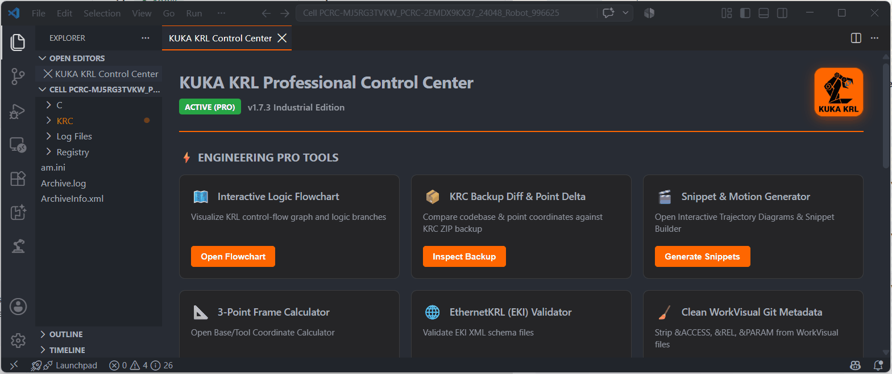

# KRC Backup Diff & Point Delta Inspector

Pro Feature

Compare current workspace logic and point coordinates against physical robot SmartPAD backup ZIP archives (KRC4 / KRC5).

## Capabilities

* **ZIP Backup Parsing**: Select any SmartPAD `.zip` archive without extracting it manually.
* **Component Point Delta Calculation**: Computes exact offset deltas (ΔX, ΔY, ΔZ, ΔA, ΔB, ΔC) for `E6POS`, `POS`, `E6AXIS`, and `AXIS` coordinates.
* **Side-by-Side Diff Viewer**: Visualizes additions, deletions, and coordinate shifts in real-time.
