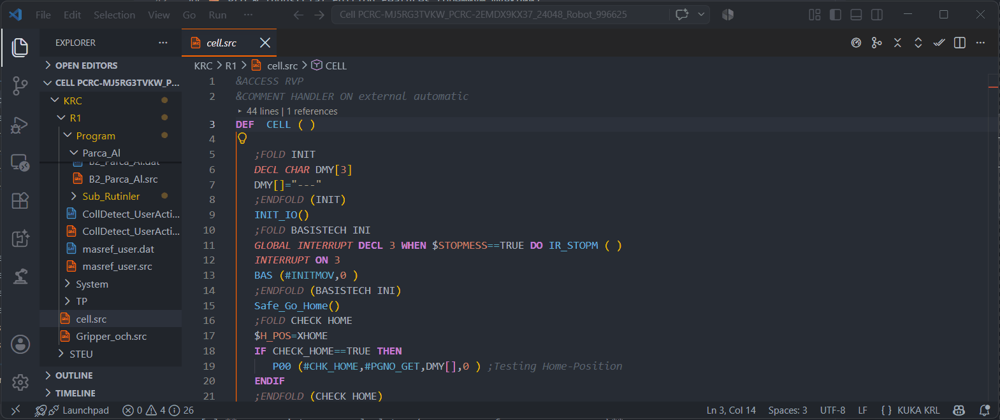

# Interactive Flowchart Viewer

Pro Feature

Stop tracing nested logic (`IF`, `SWITCH`, `LOOP`) by hand. KRL Engineering Toolkit turns complex `.src` programs into clean, visual control-flow diagrams.

## Key Features

* **Bi-directional Navigation**: Click any block in the flowchart to jump to the exact line of code in the editor or seek the 3D trajectory player in the simulator.
* **Subroutine Drill-Down**: Click subprogram calls (e.g., `GrabPart()`) to load and display their specific flowcharts with complete breadcrumb navigation.
* **Interactive Signal Simulation (Smart Action Dialog)**: Live interception of conditional branches (`IF ... THEN ... ELSE`), `HALT`, and `WAIT FOR` during 3D motion. Pause execution, simulate discrete PLC inputs, and route motion branches dynamically.
* **Multi-Robot Testing**: Hot-swap between 153 KUKA kinematic models with payload-paired linear rails ($E1) to evaluate point reachability across different machines.
* **Cell Dispatcher & PGNO Selection**: Full support for `CELL.src` main loops, interactive program card selection, and automatic return to `Check_Home`.
* **Mobile & Touch UX**: Full two-finger pinch-to-zoom and touch pan gestures, plus floating quick-access tools over the 3D viewport.
* **SVG Export**: Export vector graphics of your subprograms to embed directly into client documentation.

## How to Use
Open any `.src` file and click the `Show Control Flow Graph` icon in the top right corner of the editor, or run `KRL: Show Control Flow Graph` from the Command Palette.
