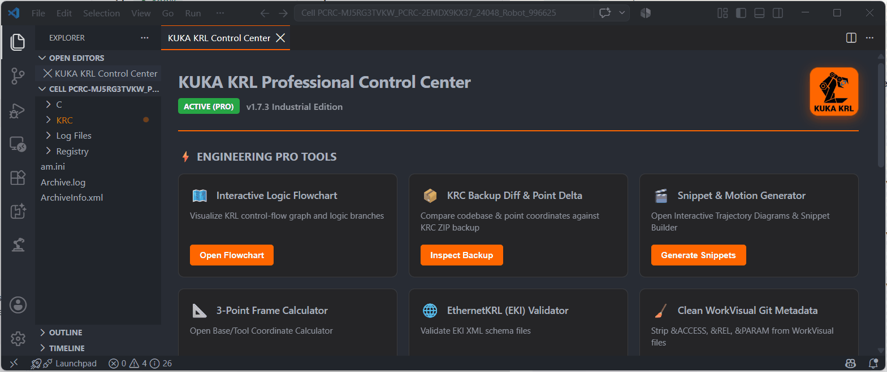

# KRC Backup Diff & Point Delta Inspector

Pro Функция

Сравнение локального проекта с ZIP-архивами бэкапов SmartPAD (KRC4 / KRC5).

## Возможности

* **Прямая распаковка архивов**: Выбор любого `.zip` бэкапа без предварительного ручного разархивирования.
* **Расчёт дельт координат точек**: Вычисление физических смещений (ΔX, ΔY, ΔZ, ΔA, ΔB, ΔC) для точек `E6POS`, `POS`, `E6AXIS`.
* **Side-by-Side инспектор**: Графическое сравнение изменений со смещениями.
