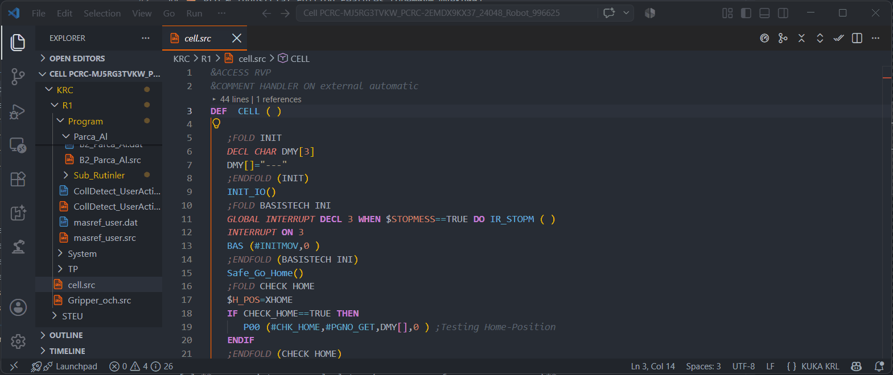

# Интерактивный просмотрщик блок-схем (Flowchart Viewer)

Pro Функция

Забудьте о ручном разборе сложных алгоритмов с десятками вложенных ветвлений `IF`, `SWITCH` и циклов `LOOP`. KUKA KRL Professional превращает программы `.src` в интерактивные блок-схемы Mermaid SVG.

## Возможности

* **Двунаправленная навигация**: Клик по любому блоку на граф-схеме переносит курсор на точную строку кода в редакторе или выполняет переход (seek) по 3D-траектории в веб-симуляторе.
* **Проваливание в подпрограммы (Drill-down)**: Клик по блоку вызова функции (например, `Kurleme()`, `TOOL_CHANGER()`, `Ic_Parca_Alma()`) мгновенно строит блок-схему этой подпрограммы с сохранением хлебных крошек навигации (Breadcrumbs).
* **Бесшовная 3D-симуляция из блок-схемы**: Кнопка «Симуляция» прямо в тулбаре просмотрщика схемы позволяет выбрать любую подпрограмму из дерева бэкапа и немедленно воспроизвести её кинематику в 3D.
* **Интерактивный KRL CELL диспетчер**: Поддержка программ `CELL.src`, выбора номера детали `PGNO` через Smart Action Dialog и циклического возврата в домашнюю позицию `Check_Home` / `HOME`.
* **Перехват условий в движении (Smart Action Dialog)**: При воспроизведении траектории симулятор автоматически обнаруживает узлы `IF`, `HALT`, `WAIT` между точками движения. Робот плавно останавливается, блок на схеме подсвечивается оранжевым контуром, а оператор может выбрать направление ветвления прямо на экране:
  - `[⚡ Ветка THEN: Симулировать $IN[15] = TRUE]`
  - `[○ Ветка ELSE: Оставить FALSE]` (робот автоматически пропустит сегменты внутри `IF` и сразу продолжит движение по ветке `ELSE`).
* **Мультимодельный 3D-тест**: Возможность мгновенно переключить модель робота на любую из 153 доступных в каталоге KUKA (с динамическим подбором совместимых рельсов $E1 по грузоподъёмности) для проверки досягаемости точек на разных манипуляторах.
* **Поддержка сенсорных устройств и смартфонов**: Полноценное управление масштабом двумя пальцами (Pinch-to-zoom), панорамирование (Touch Pan) и быстрый вызов блок-схемы прямо из плавающего тулбара над 3D-роботом.
* **Экспорт в SVG**: Скачивание векторного изображения блок-схемы для включения в проектную документацию для заказчика.

## Интеграция с 3D Digital Twin Platform

В веб-платформе цифрового двойника роботов KUKA ([liskinlabs.github.io/kuka-krl-extension/sim/](https://liskinlabs.github.io/kuka-krl-extension/sim/)) блок-схема доступна в двух режимах:
1. **Компактная мини-панель (Mini-Flow)**: располагается слева или справа, динамически подсвечивает текущий исполняемый узел в реальном времени, скроллится по горизонтали и вертикали вслед за программным указателем и свободно перемещается по экрану.
2. **Полноэкранный векторный просмотрщик (Full Flowchart)**: открывается по клику на мини-схему или кнопку «Схема» над сценой. Позволяет детально изучить алгоритм ветвления ячейки, исследовать логику `SWITCH PGNO` / `CASE`, проваливаться в подпрограммы технологических циклов и запускать их симуляцию.

## Как запустить
Откройте любой `.src` файл и нажмите иконку `Show Control Flow Graph` в верхнем правом углу редактора или выполните команду `KRL: Show Control Flow Graph`.
